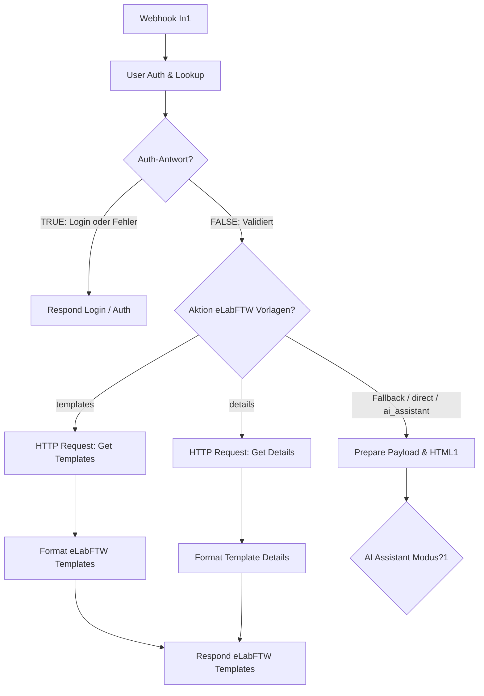

# 🧪 Anleitung: Einbau der eLabFTW-Vorlagen-Module in deinen n8n Workflow

Diese Anleitung zeigt dir Schritt für Schritt, wie du die neuen Module für:
- `action === 'get_elabftw_templates'` (Vorlagenkatalog abrufen)
- `action === 'get_elabftw_template_details'` (Metadaten-Details einer Vorlage abrufen)

in deinen bestehenden n8n Workflow einsetzt und verbindest.

---

## 📁 Bereitgestellte Modul-Dateien

Unter [`c:\Users\Thomas\Documents\GitHub\MetaFold_WebApp\n8n_workflow`](file:///c:/Users/Thomas/Documents/GitHub/MetaFold_WebApp/n8n_workflow) findest du:

1. **[`module_elabftw_combined.json`](file:///c:/Users/Thomas/Documents/GitHub/MetaFold_WebApp/n8n_workflow/module_elabftw_combined.json)** *(Empfohlen)*:
   Enthält den Weichen-Knoten `Aktion eLabFTW Vorlagen?`, beide HTTP-Requests, Formatierungs-Knoten und die Webhook-Antwort als fertigen Block.
2. **[`module_get_elabftw_templates.json`](file:///c:/Users/Thomas/Documents/GitHub/MetaFold_WebApp/n8n_workflow/module_get_elabftw_templates.json)**:
   Nur das Einzelmodul für den Katalogabruf aller Vorlagen (`/api/v2/experiments_templates`).
3. **[`module_get_elabftw_template_details.json`](file:///c:/Users/Thomas/Documents/GitHub/MetaFold_WebApp/n8n_workflow/module_get_elabftw_template_details.json)**:
   Nur das Einzelmodul für den Abruf einzelner Vorlagendetails (`/api/v2/experiments_templates/{id}`).

---

## 🛠️ Schritt-für-Schritt Einbauanleitung

### Schritt 1: `User Auth & Lookup` Knoten erweitern

Damit die MetaFold WebApp den Vorlagenkatalog auch dann abrufen kann, wenn am Terminal noch kein Nutzer per NFC/PIN eingeloggt ist (oder um den API-Key des aktuell eingeloggten Nutzers zu verwenden), füge in deinem Knoten **`User Auth & Lookup`** folgenden Code-Abschnitt ein:

Öffne **`User Auth & Lookup`** per Doppelklick und füge **vor** dem Fall 2 (`// 2. FALL: Reguläre Aktion`) diesen Block ein:

```javascript
// =========================================================================
// 🧪 FALL: eLabFTW Vorlagenkatalog & Details abrufen
// =========================================================================
if (action === 'get_elabftw_templates' || action === 'get_elabftw_template_details') {
  // Falls ein Nutzer angemeldet ist, seinen Key nutzen, sonst Standard/Fallback-Nutzer (z.B. Dr. Thomas Zobel)
  const auth = body.auth || {};
  const authId = auth.userId || body.userId;
  const authBadge = auth.badge_id;
  
  let activeUser = USERS_DB.find(u => 
    (authBadge && u.badge_id && u.badge_id.toLowerCase() === String(authBadge).toLowerCase()) ||
    (authId && u.id.toLowerCase() === String(authId).toLowerCase())
  );
  
  if (!activeUser) {
    activeUser = USERS_DB[0]; // Fallback auf ersten Benutzer (z.B. tzobel)
  }

  return {
    json: {
      is_login: false,
      is_auth_error: false,
      action: action,
      templateId: body.templateId || null,
      elab_api_key: activeUser.elab_api_key || '',
      elab_host: activeUser.elab_host || 'https://elab.uni-muenster.de',
      user: {
        id: activeUser.id,
        name: activeUser.name,
        badge_id: activeUser.badge_id
      }
    }
  };
}
```

---

### Schritt 2: Modul-Knoten in n8n einfügen

1. Öffne die Datei [`module_elabftw_combined.json`](file:///c:/Users/Thomas/Documents/GitHub/MetaFold_WebApp/n8n_workflow/module_elabftw_combined.json) im Editor (oder kopiere den gesamten JSON-Inhalt).
2. Wechsle in deinen **n8n Canvas** im Browser.
3. Klicke einmal auf eine freie Stelle der Arbeitsfläche und drücke **`Strg + V`** (bzw. `Cmd + V` auf Mac).
4. n8n fügt die neuen Knoten mit allen internen Verbindungen direkt ein:
   - **`Aktion eLabFTW Vorlagen?`** (Switch)
   - **`HTTP Request - Get eLabFTW Templates`** (GET `/api/v2/experiments_templates`)
   - **`Format eLabFTW Templates`** (Formatiert und parst `metadata.extra_fields`, inkl. Ausfallsicherung)
   - **`HTTP Request - Get eLabFTW Template Details`** (GET `/api/v2/experiments_templates/{templateId}`)
   - **`Format Template Details`**
   - **`Respond eLabFTW Templates`** (HTTP 200 mit CORS)

---

### Schritt 3: Knoten verknüpfen

Verbinde die neuen Knoten mit deinem bestehenden Flow:



**Konkrete Verbindungsschritte:**
1. Ziehe eine Verbindungslinie vom Knoten **`Auth-Antwort? (Login / Fehler)`** (unterer Ausgang `false`) zum neuen Knoten **`Aktion eLabFTW Vorlagen?`**.
2. Falls du den bestehenden Knoten `Prepare Payload & HTML1` weiter betreibst, kannst du entweder:
   - In `Aktion eLabFTW Vorlagen?` als Fallback-Output `Prepare Payload & HTML1` anbinden, **oder**
   - Vorher eine einfache Bedingung setzen: Wenn `action` mit `get_elabftw_` beginnt, leite zu eLabFTW, ansonsten zu `Prepare Payload & HTML1`.

---

### Schritt 4: Test in MetaFold WebApp v4

1. Öffne die WebApp v4 im Browser: [`v4/index.html`](file:///c:/Users/Thomas/Documents/GitHub/MetaFold_WebApp/v4/index.html).
2. Klicke oben rechts auf **⚙️ (Einstellungen)**.
3. Öffne Sektion **4. Vorlagen laden (Template Hub)**.
4. Klicke auf **`🔄 eLabFTW-Vorlagen durchsuchen`**.
5. Das Modal öffnet sich, n8n ruft deine Institutsvorlagen aus eLabFTW ab und zeigt sie mit Checkboxen und Metadaten-Feldern an.
6. Wähle die gewünschten Vorlagen aus und klicke auf **`Auswahl hinzufügen`** – die Vorlagen stehen dir nun sofort auf dem Terminal in Schritt 1 und 2 mit dem Badge `🧪 eLabFTW` zur Verfügung!
