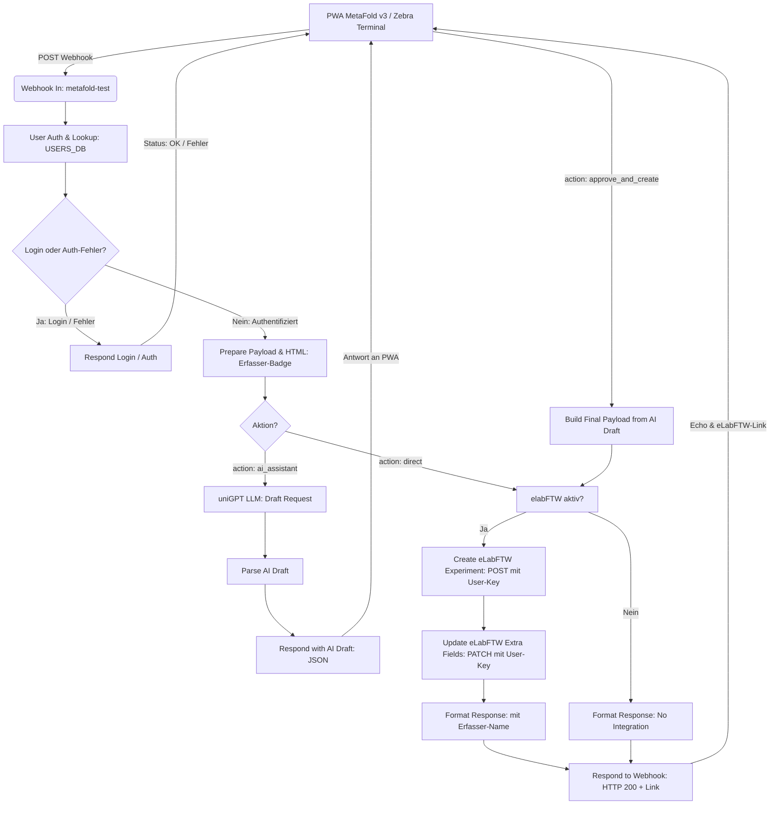

# MetaFold n8n Workflow: PWA ↔ Multi-User Auth ↔ uniGPT ↔ eLabFTW

Dieses Verzeichnis enthält den vollständigen n8n-Workflow zur automatisierten und KI-gestützten Laborerfassung zwischen dem **MetaFold Mobile Terminal (PWA v3)**, der **Benutzer-Authentifizierung (NFC / QR / PIN)**, der **uniGPT API (LLM)** und **eLabFTW (API v2)** mit **nutzerspezifischen API-Keys**.

---

## 📁 Dateien

- **[`n8n.json`](file:///c:/Users/Thomas/Documents/GitHub/MetaFold_WebApp/n8n_workflow/n8n.json)**: Der importierbare n8n-Workflow (inkl. Benutzer-Tabelle & Authentifizierung).
- **`README.md`**: Dokumentation & Setup-Anleitung.

---

## 🔄 Workflow-Architektur



---

## 🎯 Kern-Features

### 1. Multi-User Terminal & Authentifizierung (Proof of Principle)
- **Mehrere Nutzer an einem mobilen Endgerät (z. B. Zebra Android Barcode/NFC Terminal):**
  - **Zwingende Token-Identifikation:** NFC-Chip (Tag-UID) oder 2D-QR-Code (keine manuelle Benutzerauswahl per Dropdown/Buttons).
  - **Autorisierung:** Kurze 4-stellige PIN (über on-screen Keypad oder Tastatur).
- **Zentrale Tabelle in n8n (`User Auth & Lookup`):**
  - Benutzer, PINs, physische Badge-IDs und API-Keys sind direkt im Workflow in der `USERS_DB`-Tabelle hinterlegt.
  - Strenger Abgleich: Beim Login wird ausschließlich nach der physischen `badge_id` gesucht.
  ```javascript
  const USERS_DB = [
    {
      id: "tzobel",
      name: "Dr. Thomas Zobel",
      badge_id: "USER001",                   // NFC-UID oder QR-Code (z.B. USER001)
      pin: "1234",                          // 4-stellige PIN
      elab_api_key: "DEIN_ELABFTW_API_KEY", // Persönlicher eLabFTW-Key
      elab_host: "https://elab.uni-muenster.de"
    },
    ...
  ];
  ```

### 2. Dynamische API-Key-Zuordnung für eLabFTW
- Anstelle eines globalen, fest im Workflow verdrahteten API-Keys wird für jedes Experiment der **API-Key des am Terminal authentifizierten Benutzers** verwendet (`{{ $json.elab_api_key }}`).
- Dadurch wird das Experiment im elektronischen Laborbuch **unter dem echten Account des Forschers** angelegt.
- Im erstellten eLabFTW-Eintrag wird zudem optisch hervorgehoben:
  `👤 Erfasst von: Dr. Thomas Zobel (ID: tzobel)`

### 3. Strukturierter KI-Entwurf (Human-in-the-Loop)
- Aufruf des LLM-Drafts nur bei Klick auf *"Send to AI Assistant"*.
- Interaktive Prüfung und Korrektur in der PWA vor der endgültigen Übertragung.

---

## ⚙️ Konfiguration & Import in n8n

1. Öffne n8n im Browser.
2. Gehe auf **Workflows** → **Import from File...** und wähle [`n8n.json`](file:///c:/Users/Thomas/Documents/GitHub/MetaFold_WebApp/n8n_workflow/n8n.json).
3. **Benutzer-Tabelle anpassen:**
   - Öffne den Knoten **`User Auth & Lookup`**.
   - Trage in der `USERS_DB` die gewünschten Benutzer, deren physische NFC/QR-Codes (`badge_id`), PINs und eLabFTW API-Keys ein.
4. **uniGPT Token hinterlegen:**
   - Öffne **`LLM Draft Request`** und setze im Header `Authorization` deinen Bearer-Token ein (`Bearer sk-...`).
5. **Workflow aktivieren:**
   - Schalte den Workflow oben rechts in n8n auf **"Active"** (grün).
6. **Webhook URL in PWA eintragen:**
   - Kopiere die Produktions-Webhook-URL aus dem Node `Webhook In` (z. B. `https://n8n.your-lab.de/webhook/metafold-test`).
   - Öffne die PWA v3 (`v3/index.html`).
   - Klicke oben rechts auf ⚙️ (Einstellungen sind auch vor dem Login jederzeit erreichbar).
   - Trage die URL unter **n8n Webhook** ein und klicke auf **"Verbindung testen"**.

---

## 🔍 Fehlerbehebung: "Failed to fetch"

Falls in der PWA beim Anmelden oder Senden der Fehler `Failed to fetch` auftritt:

1. **Einstellungen vorher aufrufen:** Klicke direkt im Anmeldefenster oben rechts auf **⚙️ Einstellungen**, um die n8n-URL zu hinterlegen.
2. **Workflow aktiv?**
   - Wenn du eine Produktions-URL nutzt (`/webhook/...`), muss der Workflow in n8n oben rechts auf **Active** geschaltet sein.
   - Wenn du im n8n-Editor testest (`/webhook-test/...`), muss in n8n vorher auf *"Test step"* oder *"Listen for test event"* geklickt werden.
3. **HTTPS vs. HTTP (Mixed Content):**
   - Wenn die PWA über HTTPS ausgeliefert wird (z. B. GitHub Pages oder HTTPS-Server), blockieren Browser Zugriffe auf unverschlüsselte `http://`-Endpunkte als Mixed Content. Verwende immer `https://` für n8n.
4. **CORS:**
   - Alle Response-Nodes im bereitgestellten Workflow liefern standardmäßig `Access-Control-Allow-Origin: *` aus. Achte darauf, nach Änderungen in n8n den Workflow neu zu speichern.
5. **Verbindung testen:**
   - Nutze in der PWA unter **⚙️ Einstellungen** den Button **"🔌 Verbindung testen"**, um eine sofortige Diagnose mit detaillierten Hinweisen zu erhalten.
