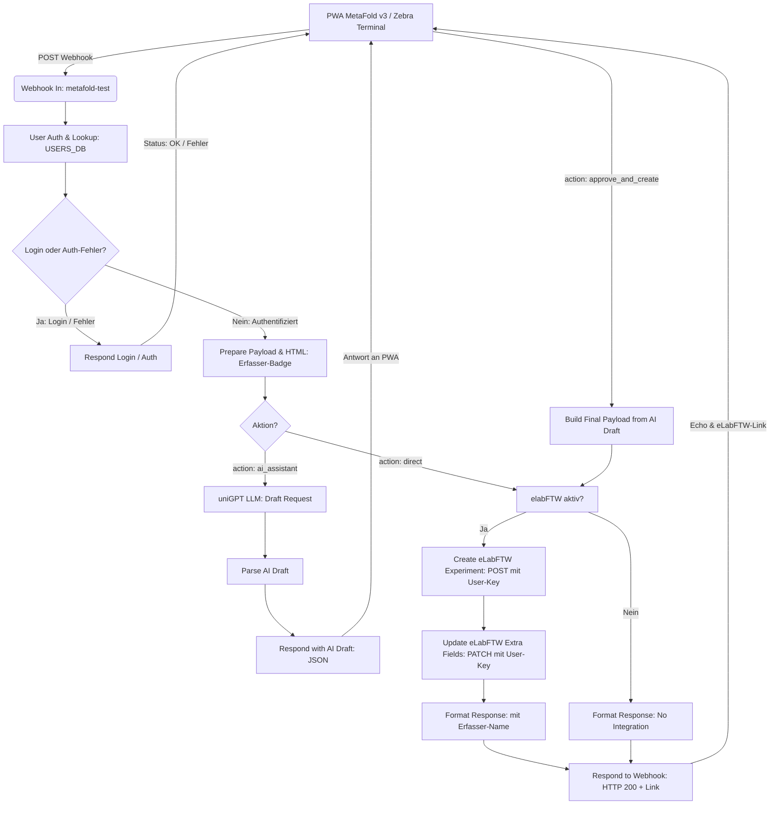

# MetaFold n8n Workflow: PWA ↔ Multi-User Auth ↔ uniGPT ↔ eLabFTW

Dieses Verzeichnis enthält den vollständigen n8n-Workflow zur automatisierten und KI-gestützten Laborerfassung zwischen dem **MetaFold Mobile Terminal (PWA v3)**, der **Benutzer-Authentifizierung (NFC / QR / PIN)**, der **uniGPT API (LLM)** und **eLabFTW (API v2)** mit **nutzerspezifischen API-Keys**.

---

## 📁 Dateien

- **[`n8n.json`](file:///c:/Users/Thomas/Documents/GitHub/MetaFold_WebApp/n8n_workflow/n8n.json)**: Der importierbare n8n-Workflow (inkl. Benutzer-Tabelle & Authentifizierung).
- **`README.md`**: Dokumentation & Setup-Anleitung.

---

## 🔄 Workflow-Architektur



---

## 🎯 Kern-Features

### 1. Multi-User Terminal & Authentifizierung (Proof of Principle)
- **Mehrere Nutzer an einem mobilen Endgerät (z. B. Zebra Android Barcode/NFC Terminal):**
  - **Identifikation:** Benutzername, Chip-Scan (NFC Tag UID) oder 2D-QR-Code.
  - **Autorisierung:** Kurze 4-stellige PIN (über on-screen Keypad oder Tastatur).
- **Zentrale Tabelle in n8n (`User Auth & Lookup`):**
  - Benutzer, PINs und API-Keys sind direkt im Workflow in der `USERS_DB`-Tabelle hinterlegt.
  - Keine externe Datenbank nötig – sofort einsatzbereit!
  ```javascript
  const USERS_DB = [
    {
      id: "tzobel",
      name: "Dr. Thomas Zobel",
      badge_id: "USER001",                   // NFC-UID oder QR-Code
      pin: "1234",                          // 4-stellige PIN
      elab_api_key: "DEIN_ELABFTW_API_KEY", // Persönlicher eLabFTW-Key
      elab_host: "https://elab.uni-muenster.de"
    },
    ...
  ];
  ```

### 2. Dynamische API-Key-Zuordnung für eLabFTW
- Anstelle eines globalen, fest im Workflow verdrahteten API-Keys wird für jedes Experiment der **API-Key des am Terminal authentifizierten Benutzers** verwendet (`{{ $json.elab_api_key }}`).
- Dadurch wird das Experiment im elektronischen Laborbuch **unter dem echten Account des Forschers** angelegt.
- Im erstellten eLabFTW-Eintrag wird zudem optisch hervorgehoben:
  `👤 Erfasst von: Dr. Thomas Zobel (ID: tzobel)`

### 3. Strukturierter KI-Entwurf (Human-in-the-Loop)
- Aufruf des LLM-Drafts nur bei Klick auf *"Send to AI Assistant"*.
- Interaktive Prüfung und Korrektur in der PWA vor der endgültigen Übertragung.

---

## ⚙️ Konfiguration & Import in n8n

1. Öffne n8n im Browser.
2. Gehe auf **Workflows** → **Import from File...** und wähle [`n8n.json`](file:///c:/Users/Thomas/Documents/GitHub/MetaFold_WebApp/n8n_workflow/n8n.json).
3. **Benutzer-Tabelle anpassen:**
   - Öffne den Knoten **`User Auth & Lookup`**.
   - Trage in der `USERS_DB` die gewünschten Benutzer, PINs und deren eLabFTW API-Keys ein.
4. **uniGPT Token hinterlegen:**
   - Öffne **`LLM Draft Request`** und setze im Header `Authorization` deinen Bearer-Token ein (`Bearer sk-...`).
5. **Webhook URL in PWA eintragen:**
   - Kopiere die Webhook-URL aus dem Node `Webhook In` (z. B. `https://n8n.your-lab.de/webhook/metafold-test`).
   - Öffne die PWA v3 (`index.html`) und trage die URL in den Einstellungen (⚙️) unter **n8n Webhook** ein.
