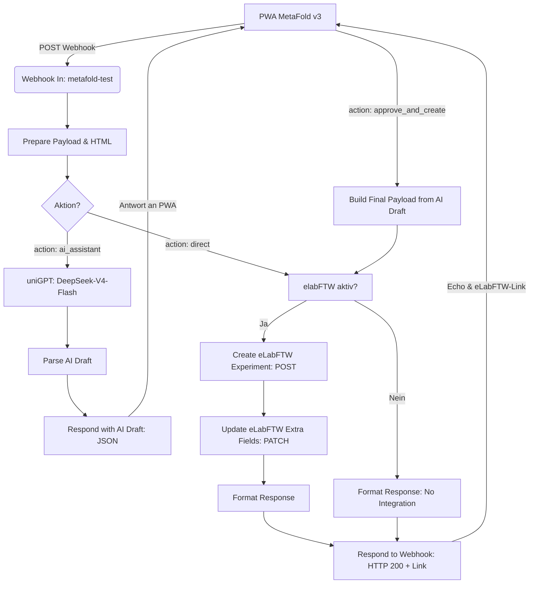

# MetaFold n8n Workflow: PWA ↔ uniGPT ↔ eLabFTW

Dieses Verzeichnis enthält den vollständigen n8n-Workflow zur automatisierten und KI-gestützten Laborerfassung zwischen dem **MetaFold Mobile Terminal (PWA v3)**, der **uniGPT API (DeepSeek-V4-Flash)** und **eLabFTW (API v2)**.

---

## 📁 Dateien

- **[`n8n.json`](file:///c:/Users/MIN/Documents/GitHub/MetaFold_WebApp/n8n_workflow/n8n.json)**: Der importierbare n8n-Workflow.
- **`README.md`**: Dokumentation & Setup-Anleitung.

---

## 🔄 Workflow-Architektur



---

## 🎯 Kern-Features & Entscheidungen

### 1. Strukturierter KI-Entwurf (Human-in-the-Loop)
- **Ein einziger KI-Call:** Die KI wird ausschließlich bei Klick auf *"Send to AI Assistant"* aufgerufen.
- **Keine Halluzinationen:** Der System-Prompt zwingt das Modell, **ausschließlich existierende Template-Felder** zu belegen.
- **Antwortformat:**
  ```json
  {
    "status": "ai_draft",
    "ai_draft": {
      "title": "[MetaFold] Airyscan SR - 14.10.2026",
      "metadata": {
        "mode": "Airyscan SR",
        "laser_power": 2.5
      },
      "additional_notes": "Probe zeigte leichte Fluoreszenz-Ausbleichung im Randbereich."
    }
  }
  ```
- **Zusätzliche Notizen:** Alle Angaben aus der Sprachnotiz, die zu keinem Template-Feld passen, landen sauber in `additional_notes` und werden nicht in unpassende Felder gezwungen.

### 2. Interaktive Klick-Korrektur in der PWA (v3)
- In der PWA wird der Entwurf zeilenweise antippbar dargestellt (`aiDraftRows`).
- **Typ-spezifische Controls:**
  - **Dropdown/Select:** Zeigt direkt die aus dem Template hinterlegten Optionen.
  - **Checkbox:** Interaktiver Umschalter (✓ Ja / Nein).
  - **Rating:** Interaktive 1–5 Sterne.
  - **Multi-Checkbox:** Klickbare Pill-Buttons.
  - **Text/Zahl/Datum:** Passende Eingabefelder.

### 3. Native eLabFTW "Extra Fields" Integration (API v2)
- Metadaten landen nicht nur als Fließtext/Tabelle im Body, sondern im nativen eLabFTW-Feature **Extra Fields** (`metadata.extra_fields`).
- **2-Phasen-Speicherung (POST + PATCH):**
  1. `POST /api/v2/experiments`: Erstellt das Experiment mit Titel & Body.
  2. `PATCH /api/v2/experiments/{id}`: Schreibt die strukturierten `extra_fields` inklusive Typ, Optionen und Beschreibungen.
- **Freitext-Body:** Enthält die formatierten Notizen (`additional_notes`) und eine saubere HTML-Zusammenfassung als Fallback/Übersicht.

---

## ⚙️ Konfiguration & Import in n8n

1. Öffne n8n im Browser (z. B. deine Lab-Instanz).
2. Gehe auf **Workflows** → **Import from File...** und wähle [`n8n.json`](file:///c:/Users/MIN/Documents/GitHub/MetaFold_WebApp/n8n_workflow/n8n.json).
3. **API-Schlüssel prüfen/anpassen:**
   - **Node `LLM Draft Request`:**
     - URL: `https://gpt.uni-muenster.de/v1/chat/completions`
     - Header `Authorization`: `Bearer <DEIN_UNIGPT_TOKEN>`
     - Modell: `DeepSeek-V4-Flash`
   - **Nodes `Create eLabFTW Experiment` & `Update eLabFTW Extra Fields (PATCH)`:**
     - URL: `https://elab.uni-muenster.de/api/v2/experiments`
     - Query / Header `Authorization`: `<DEIN_ELABFTW_API_KEY>`
4. **Webhook URL in PWA eintragen:**
   - Kopiere die Webhook-URL aus dem Node `Webhook In` (z. B. `https://n8n.your-lab.de/webhook/metafold-test`).
   - Öffne die PWA v3 (`index.html`) und trage die URL in den Einstellungen (⚙️) unter **n8n Webhook** ein.
